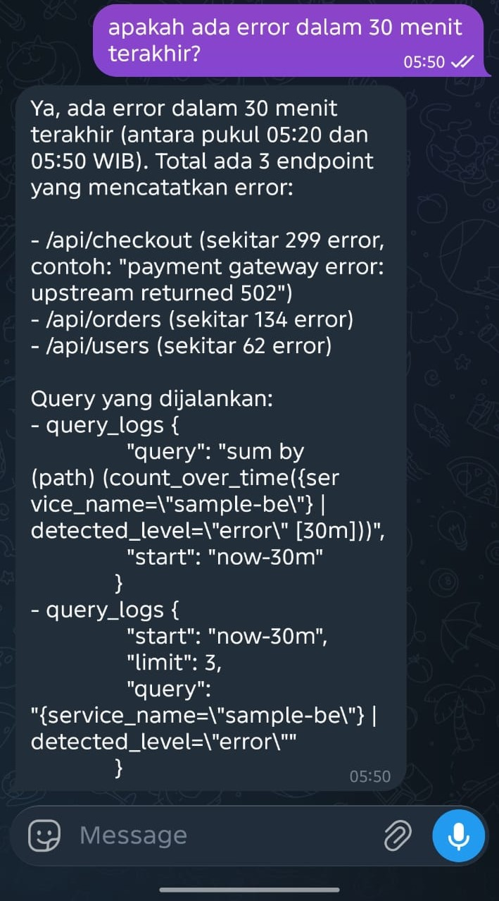
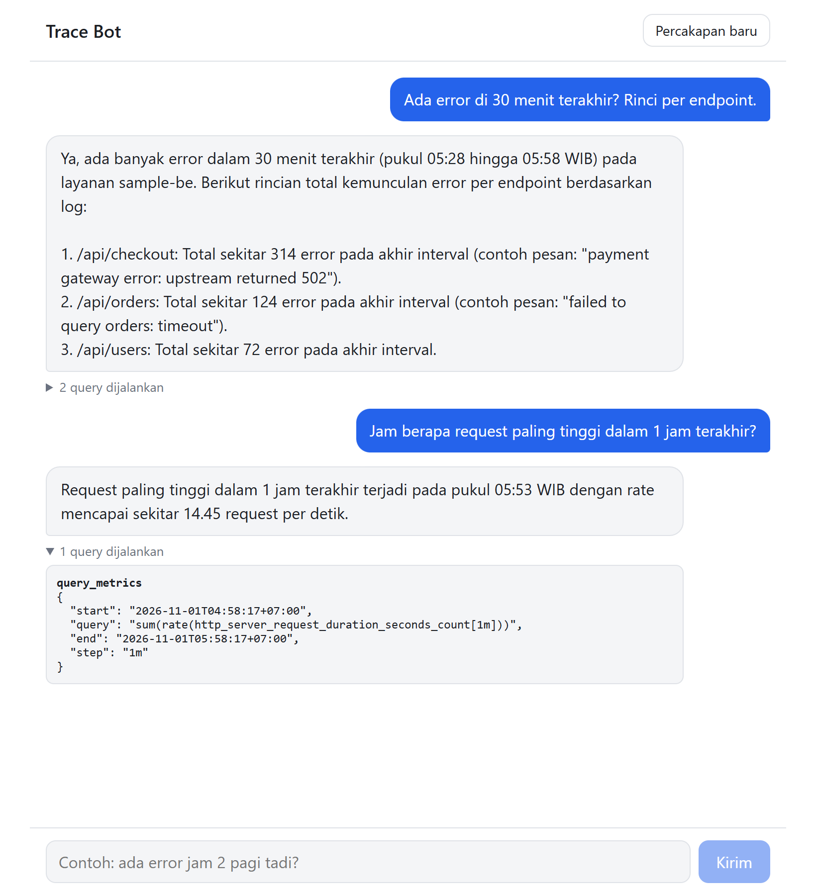
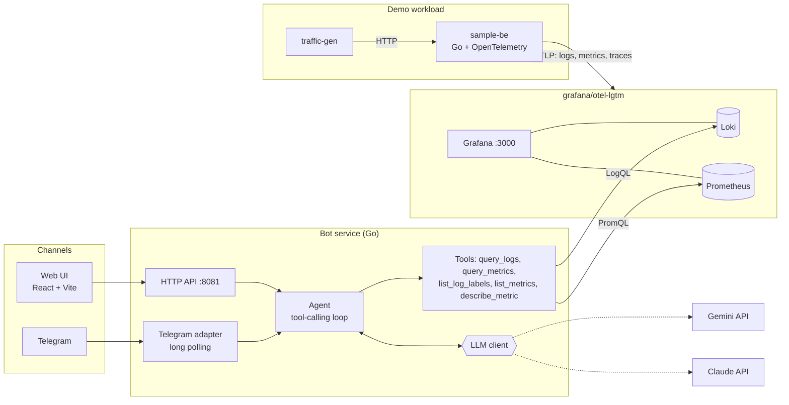
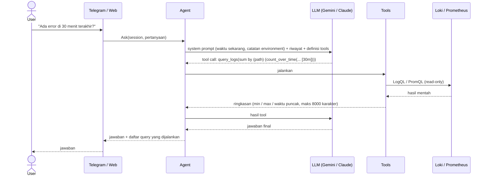

# Trace Bot

PoC bot AI yang menjawab pertanyaan soal **log dan metrics** backend lewat **Telegram** atau **web chat**, dalam bahasa biasa:

> "Ada error di 30 menit terakhir?" · "Jam berapa request paling tinggi?" · "Endpoint mana yang paling lambat?"

Bot tidak membaca semua log. LLM (Gemini atau Claude) diberi *tools* untuk query Loki (log) dan Prometheus (metrics), menjalankan query yang dia susun sendiri, lalu merangkum hasilnya. Semua jalan lokal lewat Docker Compose, termasuk service sample untuk dipantau.

| Telegram | Web |
|---|---|
|  |  |

Kedua channel menampilkan **query yang benar-benar dijalankan**, jadi jawaban bisa diverifikasi, bukan sekadar dipercaya.

## Arsitektur



Telegram dan web hanya adapter tipis. Keduanya memanggil satu fungsi yang sama, `Agent.Ask(session, question)`, jadi channel baru (Slack, Discord, dsb.) cukup menambah satu adapter.

### Alur satu pertanyaan



Keputusan desain yang penting:

- **LLM tidak diberi raw log.** Hasil query diringkas (min/max/avg, waktu puncak, sampel titik) dan dibatasi ukurannya. Hemat token, dan pertanyaan seperti "peak jam berapa" bisa dijawab tanpa ribuan titik data.
- **Kalau query salah, LLM mencoba lagi.** Pesan error dari Loki/Prometheus dikembalikan ke LLM sebagai hasil tool, bukan menghentikan proses. Maksimal 8 langkah per pertanyaan.
- **Provider LLM bisa ditukar** lewat satu env var. Gemini dan Claude berada di belakang satu interface kecil (`llm.Client`) dengan format tool calling masing-masing.
- **Read-only.** Bot hanya memakai endpoint query, tidak bisa mengubah apa pun di backend.
- **Waktu dipahami dalam zona waktu lokal.** System prompt memuat waktu saat ini dan `TIMEZONE`, jadi "jam 2 pagi tadi" di-resolve ke WIB, bukan UTC.

## Stack

| Bagian | Teknologi |
|---|---|
| Observability | [`grafana/otel-lgtm`](https://github.com/grafana/docker-otel-lgtm): Grafana, Loki, Tempo, Prometheus, OTel collector dalam satu container |
| Service sample | Go + OpenTelemetry SDK (traces, metrics, logs lewat OTLP/HTTP) |
| Bot dan agent | Go, tanpa framework agent. LLM dipanggil lewat REST langsung |
| LLM | Gemini (default `gemini-3.5-flash-lite`) atau Claude (default `claude-sonnet-5-5`) |
| Telegram | [go-telegram/bot](https://github.com/go-telegram/bot), long polling (tanpa public URL atau webhook) |
| Web | React + Vite + TypeScript |
| Orkestrasi | Docker Compose |

## Struktur repo

```
cmd/
  bot/            entrypoint bot (HTTP API + Telegram)
  sample-be/      service demo dengan endpoint /api/users, /api/orders, /api/checkout
  traffic-gen/    pembuat traffic dengan pola gelombang sinus
internal/
  config/         baca env
  llm/            interface Client + implementasi Gemini dan Claude
  tools/          query Loki dan Prometheus, parser waktu, ringkasan hasil
  agent/          loop tool calling, riwayat sesi, system prompt
  telegram/       adapter Telegram
  httpapi/        adapter web (JSON API, CORS, bearer token opsional)
web/              chat UI (React + Vite)
docs/             screenshot
```

## Menjalankan di lokal

### Prasyarat

- Docker Desktop (atau Docker Engine + Compose v2)
- Node.js 20.19+ atau 22.12+ (hanya untuk web UI, syarat Vite 8)
- Go 1.26+ (opsional, hanya kalau mau menjalankan atau mengembangkan bot tanpa Docker)
- API key **Gemini** ([AI Studio](https://aistudio.google.com/apikey)) dan/atau **Anthropic** ([Console](https://console.anthropic.com/settings/keys))
- (Opsional) bot Telegram. Tanpa token Telegram, bot tetap jalan untuk web.

### 1. Clone dan siapkan `.env`

```bash
git clone https://github.com/ardwiinoo/trace-bot.git
cd trace-bot
cp .env.example .env        # Windows PowerShell: copy .env.example .env
```

Isi minimal di `.env`:

```env
LLM_PROVIDER=gemini                 # atau: claude
GEMINI_API_KEY=...                  # kalau LLM_PROVIDER=gemini
ANTHROPIC_API_KEY=...               # kalau LLM_PROVIDER=claude
TELEGRAM_BOT_TOKEN=...              # opsional, dari @BotFather
TELEGRAM_ALLOWED_USER_IDS=          # kosongkan dulu, lihat langkah 4
```

`.env` sudah ada di `.gitignore`. Jangan commit key.

### 2. Jalankan stack

```bash
docker compose up -d --build
```

Ini menjalankan Grafana stack, service sample, traffic generator, dan bot. Tunggu 1 sampai 2 menit supaya ada data.

| Service | URL |
|---|---|
| Grafana (login `admin` / `admin`) | http://localhost:3000 |
| sample-be | http://localhost:8080 |
| Bot HTTP API | http://localhost:8081 |

Cek data masuk: di Grafana buka **Explore**, pilih Loki, query `{service_name="sample-be"}`. Untuk Prometheus, cari metric `http_server_request_duration_seconds_count`.

### 3. Jalankan web UI

```bash
cd web
npm install
npm run dev
```

Buka http://localhost:5173. Kalau bot tidak di `localhost:8081`, salin `web/.env.example` ke `web/.env.local` dan ubah `VITE_API_URL`. Origin web juga harus cocok dengan `WEB_ORIGIN` di `.env` bot (default `http://localhost:5173`).

### 4. Hubungkan Telegram

1. Chat ke [@BotFather](https://t.me/BotFather), kirim `/newbot`, lalu salin token ke `TELEGRAM_BOT_TOKEN`.
2. Restart bot: `docker compose up -d bot`.
3. Kirim pesan apa saja ke bot kamu. Karena allowlist masih kosong, bot membalas **User ID** kamu.
4. Isi `TELEGRAM_ALLOWED_USER_IDS=<id kamu>` (pisahkan dengan koma untuk beberapa orang), lalu restart bot lagi.
5. Tanya sesukamu. Perintah: `/help`, `/reset` (mulai percakapan baru).

> Satu token Telegram hanya boleh di-poll oleh **satu** proses. Kalau Docker sedang menjalankan bot, jangan jalankan `go run ./cmd/bot` bersamaan, karena Telegram akan menolak dengan error 409.

### Contoh pertanyaan

- Ada error di 30 menit terakhir? Rinci per endpoint.
- Jam berapa request paling tinggi dalam 1 jam terakhir?
- Endpoint mana yang paling banyak error?
- Berapa p95 latency per endpoint?
- Dari error tadi, contoh pesan errornya apa saja? *(pertanyaan lanjutan memakai riwayat sesi)*

Data demo dibuat supaya ada sesuatu untuk ditanyakan: `/api/checkout` error sekitar 10%, `/api/orders` 3%, `/api/users` 1%. Rate request naik-turun antara 1 sampai 15 req/s dalam siklus 10 menit.

## Konfigurasi

| Variabel | Default | Keterangan |
|---|---|---|
| `LLM_PROVIDER` | `gemini` | `gemini` atau `claude` |
| `GEMINI_API_KEY`, `GEMINI_MODEL` | - , `gemini-3.5-flash-lite` | |
| `ANTHROPIC_API_KEY`, `ANTHROPIC_MODEL` | - , `claude-sonnet-5-5` | |
| `TELEGRAM_BOT_TOKEN` | kosong | Kosong = adapter Telegram nonaktif, web tetap jalan |
| `TELEGRAM_ALLOWED_USER_IDS` | kosong | Daftar user ID dipisah koma. Kosong = semua ditolak |
| `LOKI_URL`, `PROMETHEUS_URL` | `localhost:3100`, `localhost:9090` | Di Docker otomatis di-override ke nama service |
| `TIMEZONE` | `Asia/Jakarta` | Dipakai untuk menafsirkan dan menampilkan waktu |
| `HTTP_ADDR` | `:8081` | Alamat HTTP API |
| `WEB_ORIGIN` | `http://localhost:5173` | Origin yang diizinkan CORS |
| `WEB_API_TOKEN` | kosong | Kalau diisi, `/api/*` butuh `Authorization: Bearer <token>` |

Mengganti ke Claude: set `LLM_PROVIDER=claude` dan isi `ANTHROPIC_API_KEY`, lalu `docker compose up -d bot`.

## HTTP API

| Method | Path | Body | Respons |
|---|---|---|---|
| `POST` | `/api/chat` | `{"session_id": "abc", "message": "ada error?"}` | `{"answer": "...", "queries": [{"tool": "...", "args": "..."}]}` |
| `POST` | `/api/reset` | `{"session_id": "abc"}` | `204` |
| `GET` | `/healthz` | - | `ok` |

```bash
curl -X POST http://localhost:8081/api/chat \
  -H "Content-Type: application/json" \
  -d '{"session_id":"demo","message":"ada error di 30 menit terakhir?"}'
```

Riwayat disimpan di memori per `session_id` (6 pasang tanya-jawab terakhir) dan hilang saat bot restart.

## Keterbatasan dan catatan

- **Free tier LLM terbatas.** Gemini free tier membatasi request per menit dan per hari (per model). Satu pertanyaan memakai 2 sampai 4 panggilan LLM, jadi mencoba-coba banyak bisa menghabiskan kuota harian. Bot langsung memberi pesan jelas saat itu terjadi. Solusinya: aktifkan billing, ganti `GEMINI_MODEL`, atau pindah ke `LLM_PROVIDER=claude`.
- **Jawaban LLM tidak dijamin akurat.** Angka berasal dari query yang bisa kamu lihat di bawah tiap jawaban. Bandingkan dengan Grafana kalau ragu. Total sering sedikit berbeda dari hitungan manual karena bot menjumlahkan jendela waktu dan data terus bertambah.
- **Data baru ada setelah stack jalan.** Pertanyaan seperti "peak jam berapa" baru bermakna setelah traffic generator berjalan beberapa siklus.
- **Hanya log dan metrics.** Traces (Tempo) sudah masuk di stack tapi belum punya tool.
- **Keamanan.** Ini PoC. Telegram dibatasi allowlist user ID, tapi `WEB_API_TOKEN` yang dipakai lewat `VITE_API_TOKEN` akan ikut ke bundle browser, jadi bukan rahasia sungguhan. Untuk produksi, letakkan di belakang auth proxy, dan perhatikan PII yang mungkin ada di log kamu karena potongan log dikirim ke penyedia LLM.

## Troubleshooting

| Gejala | Penyebab / solusi |
|---|---|
| `failed to connect to the docker API` | Docker Desktop belum jalan |
| Bot tidak membalas di Telegram, log `409 Conflict` | Ada dua proses yang memakai token yang sama |
| Bot membalas dengan "User ID kamu" | User ID belum ada di `TELEGRAM_ALLOWED_USER_IDS` |
| Web: error CORS atau "Failed to fetch" | `WEB_ORIGIN` tidak sama persis dengan alamat web (`localhost` dan `127.0.0.1` dianggap beda) |
| Error "kuota harian free tier habis" | Lihat bagian keterbatasan di atas |
| Jawaban "tidak ada data" | Stack baru jalan. Tunggu 1 sampai 2 menit, lalu cek Explore di Grafana |
| Logs bot | `docker compose logs -f bot` (setiap tool call tercatat) |

## Pengembangan

```bash
go vet ./... && go test ./...      # tes memakai fake Loki/Prometheus dan fake LLM, tanpa jaringan
go run ./cmd/bot                   # jalankan bot di host (stack Docker tetap dibutuhkan untuk data)
cd web && npm run build && npm run lint
```

## Ide lanjutan

- Tool untuk traces (Tempo/TraceQL), lalu dari log error langsung loncat ke trace lewat `trace_id`.
- Alert proaktif: bot mengirim pesan sendiri saat error rate melonjak.
- Streaming jawaban di web, dan riwayat sesi yang persisten.
- Adapter channel lain (Slack, Discord).
